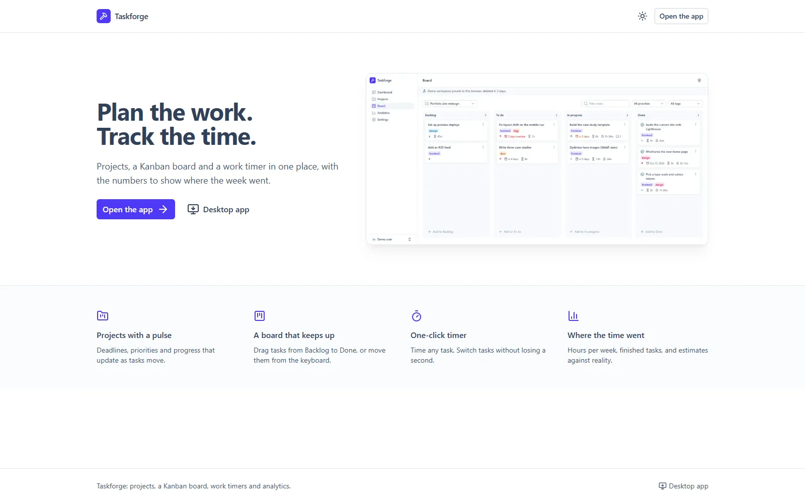
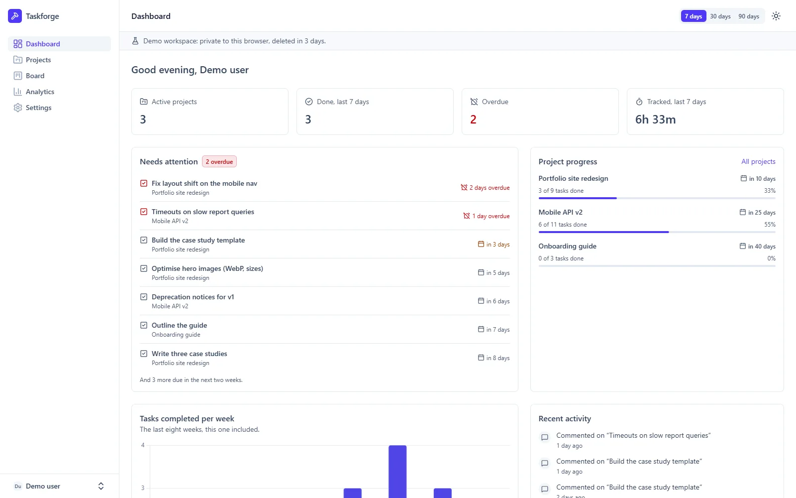
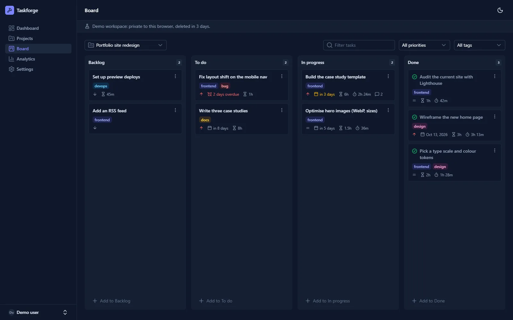
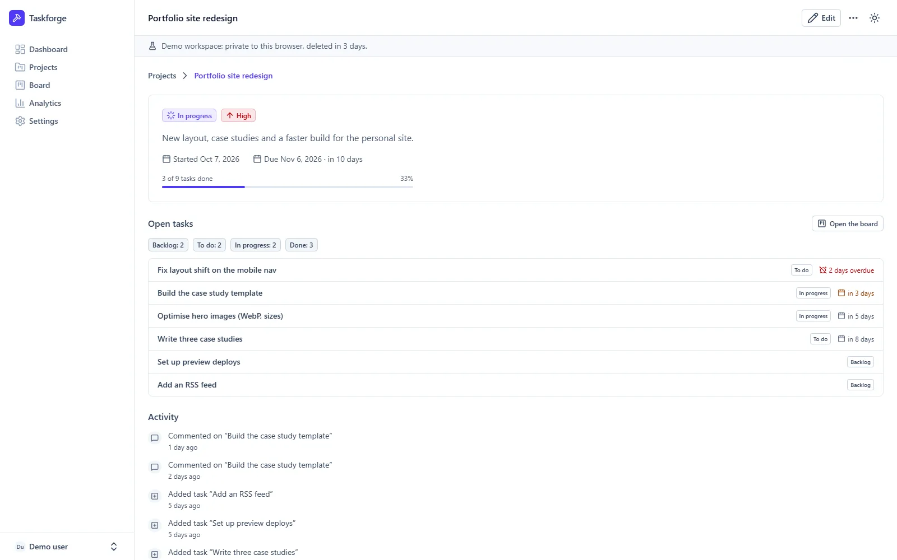
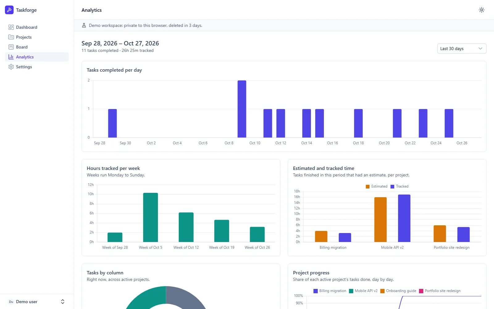
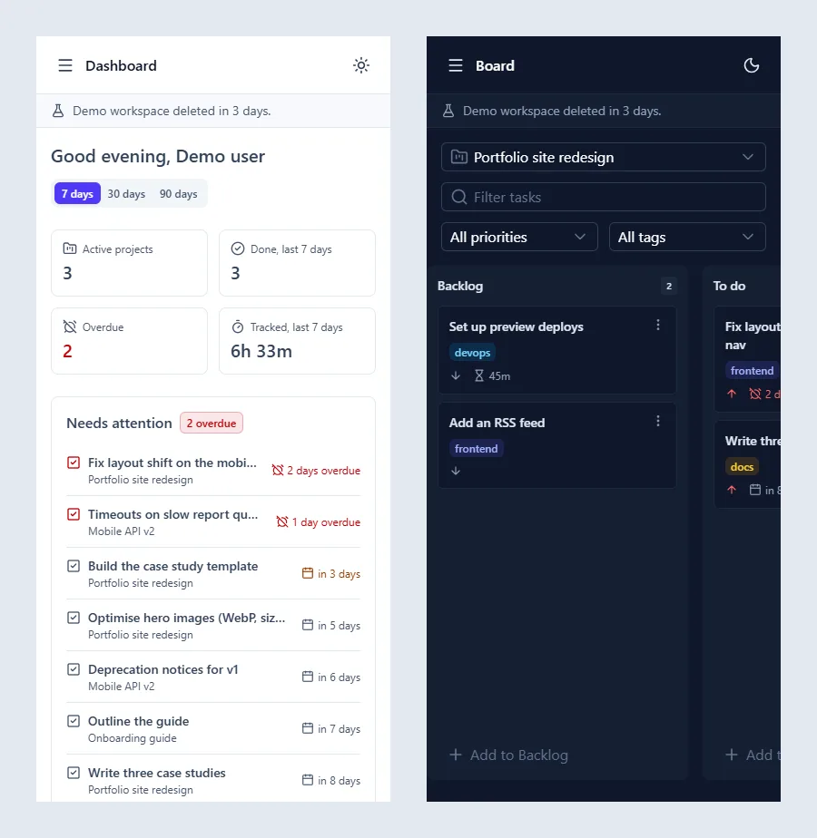

# Taskforge

Project management and time tracking for developers. Taskforge has:
- projects with deadlines and progress;
- a Kanban board;
- a one-click work timer;
- analytics that show where the week went.

It runs in the browser, and as a desktop app for Windows and Linux.

**Live:** <https://taskforge-seven-flax.vercel.app>. Choose **Try the demo**: no sign-up needed.
**Desktop installers:** [latest release](https://github.com/johnmichaelcastillo-10/taskforge/releases/latest).



## Features

- **Try the demo:** one click opens a private workspace with sample projects, tasks and tracked
  time, no sign-up needed. It's deleted after three days.
- **Projects:**
  - status, priority, start date and deadline;
  - progress worked out from their tasks, and an activity history;
  - archiving makes a project read-only until it's restored.
- **Kanban board:** Backlog, To do, In progress and Done.
  - Drag and drop, or move cards from the keyboard with each card's Move menu.
  - Tasks have tags, due dates, estimates and comments, and quick add per column.
  - Finishing a task stamps its completion time; reopening it clears that time.
- **Work timer:** start it from any task and switch tasks without losing a second.
  - Durations are measured by the server.
  - One timer runs at a time, guaranteed by the database.
  - The running timer shows in the top bar on every page.
- **Dashboard:** active projects, work done and time tracked over 7, 30 or 90 days. What's
  overdue and coming up comes first, then project progress, a weekly chart and recent activity.
- **Analytics:** for any date range, all in your time zone:
  - tasks completed per day and hours tracked per week;
  - estimated against tracked time;
  - tasks by column and project progress over time.
- **REST API:** `/api/v1` with personal access tokens, stored hashed. See
  [docs/API.md](docs/API.md).
- **Desktop app** for Windows and Linux, built with Tauri:
  - the running timer in the system tray;
  - notifications;
  - a global shortcut (Ctrl+Shift+Space).
- **Dark mode**, responsive down to phone width, and keyboard and screen-reader friendly (charts
  come with data tables).

| Dashboard | Board (dark mode) |
|---|---|
|  |  |
| **Project** | **Analytics** |
|  |  |

<p align="center"></p>

## How it's built

- **Framework:** Nuxt 4 (Vue 3, TypeScript), with server routes for the backend.
- **UI:** Nuxt UI 4 and Tailwind CSS 4; Chart.js for the charts; vue-draggable-plus for the
  board.
- **Data:** SQLite through libSQL, with Drizzle ORM and SQL migrations. It's a local file in
  development, and Turso when hosted.
- **Validation:** Zod schemas, shared by the forms and the server.
- **Security:** a strict CSP with nonces, rate limits stored in the database, sealed session
  cookies, and scrypt password hashes.
- **Desktop:** Tauri 2 (Rust), wrapping the hosted site.
- **Tests:** Vitest, with unit tests and end-to-end tests against the production build. GitHub
  Actions runs lint, type check, tests, the build, a Docker health check, and the desktop
  installers.

More detail:

| Document | What's in it |
|---|---|
| [docs/ARCHITECTURE.md](docs/ARCHITECTURE.md) | Request flow, data model, time zones, security and trade-offs |
| [docs/API.md](docs/API.md) | The REST API |
| [docs/DEPLOY.md](docs/DEPLOY.md) | Deploying to Vercel and Turso |
| [docs/SPEC.md](docs/SPEC.md) | The original specification and roadmap |

## Requirements

Only Docker. Node, npm and SQLite all run inside containers.

- **Windows 10/11:** Docker Desktop with the WSL 2 backend.
- **Linux:** Docker Engine with the Compose plugin.

## Quick start

From the repository folder:

**PowerShell (Windows)**

```powershell
Copy-Item .env.example .env
docker compose up --build -d
```

**Bash (Linux, macOS or WSL)**

```bash
cp .env.example .env
docker compose up --build -d
```

Open <http://localhost:8094> and choose **Try the demo**.

The health check is at <http://localhost:8094/api/health>:

```json
{"status":"ok","checks":{"database":"ok"}}
```

It returns HTTP 503 with `"database":"unavailable"` when the database can't be reached.

On start, the container applies any pending migrations, then starts the server. Its data lives
on the `taskforge-data` volume, which survives restarts, rebuilds and `docker compose down`. If
`.env` has no `NUXT_SESSION_PASSWORD`, the first start generates one and keeps it on the same
volume, so sign-ins survive restarts too.

## Everyday commands

Run them from the repository folder. They are the same in PowerShell and Bash.

| Task | Command |
|---|---|
| Start, or rebuild after changes | `docker compose up --build -d` |
| Follow the logs | `docker compose logs -f app` |
| Status and health | `docker compose ps` |
| Stop, keeping data | `docker compose down` |
| Apply migrations by hand | `docker compose exec app node migrator/migrate.mjs` |

## Development

The `dev` service mounts the source into a Node container, so you get live reload without
installing Node locally:

```bash
docker compose --profile dev up dev
```

Open <http://localhost:3000>. The first start installs dependencies into `node_modules` and
takes a few minutes; later starts are quicker. The dev server uses its own database,
`data/dev.db`, separate from the app container's volume. Sign-up is on in development.

Use the same service for every npm command:

| Task | Command |
|---|---|
| Unit and end-to-end tests | `docker compose run --rm dev npm test` |
| Lint | `docker compose run --rm dev npm run lint` |
| Type check | `docker compose run --rm dev npm run typecheck` |
| Production build | `docker compose run --rm dev npm run build` |
| Generate a migration after editing `server/database/schema.ts` | `docker compose run --rm dev npm run db:generate` |
| Apply migrations to the dev database | `docker compose run --rm dev npm run db:migrate` |
| Install a package | `docker compose run --rm dev npm install <package>` |

The end-to-end tests build the app once, then start a server per test file, each on its own
temporary SQLite file with migrations applied.

## Desktop app

The desktop app (`desktop/`) opens a Taskforge site in its own window. GitHub Actions builds the
installers ([.github/workflows/desktop.yml](.github/workflows/desktop.yml)):
- Windows: `.msi` and `.exe`;
- Linux: `.deb` and `.AppImage`.

Set the repository variable `TASKFORGE_URL` to the site the installers should open. Pushing a
tag such as `v1.0.0` drafts a release with them attached.

To build the Linux package locally with only Docker, run this from `desktop/`. In PowerShell,
use `-v "${PWD}:/desktop"`.

```bash
docker run --rm -v "$PWD:/desktop" -w /desktop -e TASKFORGE_URL=https://your-site node:24-slim sh scripts/build-linux.sh
```

Without `TASKFORGE_URL`, the app opens the local Docker app at <http://localhost:8094>. Point the
site's download page at the published installers with `NUXT_PUBLIC_DOWNLOADS_URL`.

## Resetting local data

> **Warning:** this permanently deletes every account and all their data in the local app, and
> signs everyone out.

```bash
docker compose down --volumes
docker compose up -d
```

`--volumes` removes the `taskforge-data` volume. A plain `docker compose down` never does.

To reset only the dev database, delete it. In PowerShell:

```powershell
Remove-Item data/dev.db*
```

In Bash:

```bash
rm data/dev.db*
```

## Configuration

Settings live in `.env`, copied from [.env.example](.env.example). Never commit `.env`.

| Variable | Default | Purpose |
|---|---|---|
| `APP_PORT` | `8094` | Host port of the app container |
| `DEV_PORT` | `3000` | Host port of the dev server |
| `DEV_UID`, `DEV_GID` | `1000` | Linux only: the user the dev container runs as (see Troubleshooting) |
| `NUXT_SESSION_PASSWORD` | *(generated)* | Encrypts session cookies; 32+ characters. Generated locally if empty; required in production |
| `NUXT_PUBLIC_REGISTRATION_ENABLED` | `false` (`true` in dev) | Allows sign-up |
| `NUXT_DEMO_TTL_HOURS` | `72` | How long a demo account lives |
| `NUXT_TRUST_PROXY` | `false` | Read client addresses from `X-Forwarded-For`; only behind a proxy that sets it (Vercel) |
| `NUXT_PUBLIC_DOWNLOADS_URL` | *(empty)* | Where the download page links for the desktop installers |
| `NUXT_DATABASE_URL` | `file:./data/taskforge.db` | Database URL for running outside Docker; Turso uses `libsql://…` |
| `NUXT_DATABASE_AUTH_TOKEN` | *(empty)* | Turso auth token |

## Troubleshooting

- **Port already in use:** set another `APP_PORT` or `DEV_PORT` in `.env`, then run
  `docker compose up -d` again.
- **Slow dev server on Windows:** a project in a Windows folder (`C:\…`) reaches the container
  through a slower file share, so the dev service polls for changes. Cloning inside WSL (for
  example `~/projects/taskforge` in Ubuntu) and running Docker from there is much faster.
- **Edits don't reload:** make sure the `dev` service is running (`docker compose ps`). Polling is
  on by default (`WATCH_POLLING=true` in `compose.yaml`).
- **`EACCES` / permission denied on Linux:** the dev container runs as user id 1000 by default,
  the usual id of the first Linux user. If `id -u` shows something else, add your ids to `.env`:

  ```bash
  echo "DEV_UID=$(id -u)" >> .env
  echo "DEV_GID=$(id -g)" >> .env
  ```

  Files created earlier by another user can be handed back with
  `sudo chown -R "$(id -u):$(id -g)" node_modules .nuxt .output data`.
- **"Too many attempts":** sign-in, sign-up and demo creation are rate-limited per address. Wait
  for the time the message gives.
- **Signed out after a restart:** the session secret changed. Keep `NUXT_SESSION_PASSWORD` fixed
  in `.env`, or leave it empty and keep the volume (or `data/session-password` in development).
- **App container unhealthy:** check `docker compose logs app`. A failed migration stops the
  container before the server starts, and the error is in the log.
- **Docker Hub download errors** (`connection reset`, `EOF`): run the command again; pulls
  resume.
