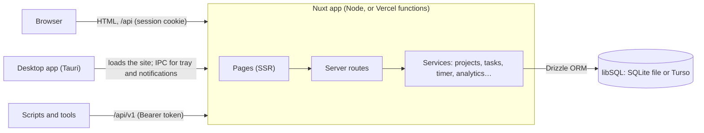
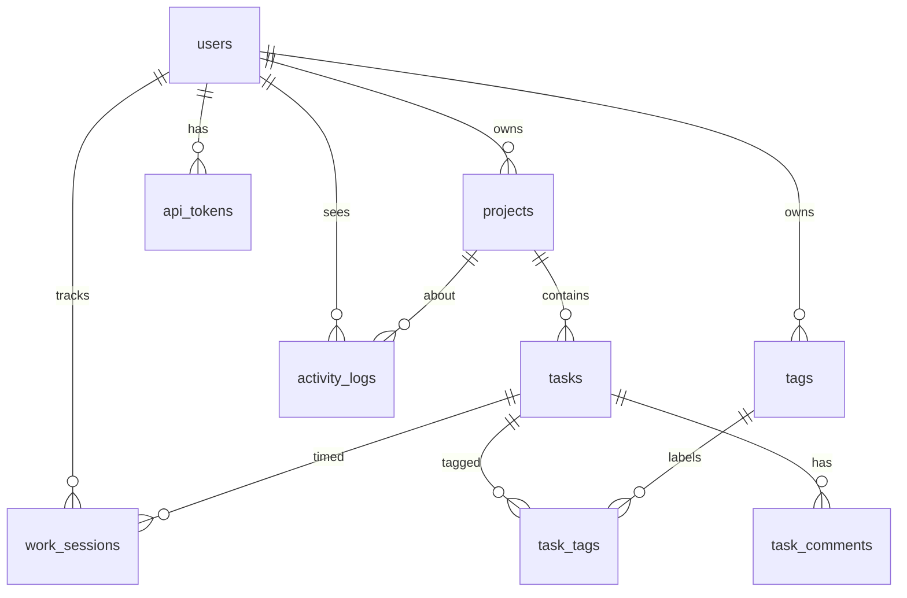

# Architecture

Taskforge is one Nuxt application: Vue pages rendered on the server, and a backend of Nitro
server routes, sharing TypeScript types and validation. Data lives in SQLite through libSQL: a
local file in development and Docker, and Turso when hosted. A Tauri shell wraps the hosted site
for the desktop.



## Layout

```text
app/                    The Vue side
  pages/                One file per route (file-based routing)
  layouts/              Public pages vs. the signed-in app (sidebar)
  components/           Cards, the task panel, charts, forms
  composables/          Shared state: the timer, tags, "today", chart theme
  plugins/              The desktop bridge (only active inside Tauri)
server/
  api/                  The app's routes (session cookie)
  api/v1/               The public REST API (tokens)
  services/             Business logic, shared by both route sets
  database/             Drizzle schema and SQL migrations
  utils/                Database access, accounts, rate limits, validation (auto-imported)
  plugins/              Session checks, response compression
shared/                 Validation schemas, constants, date and format helpers, wire types
desktop/                The Tauri shell (Rust) and its build scripts
tests/unit, tests/e2e   Vitest; the e2e tests run the production build
```

## Requests

- **App routes (`/api/…`)** call `requireAccount()`.
  - It reads the sealed session cookie, then loads the account from the database. A deleted
    account, or an expired demo, counts as signed out, whatever the cookie says.
  - The session's `fetch` hook applies the same check when a page is rendered.
- **API routes (`/api/v1/…`)** call `requireApiAccount()`.
  - It hashes the Bearer token, looks it up, and loads the account.
  - Each token has its own rate limit.
  - Cookies are not accepted there, and tokens are not accepted by the app's routes.
- **Services** take the database (or a transaction) and the acting user's id. Every query is
  scoped to that user through the project's `owner_id`. Someone else's record gets the same 404
  as a missing one, so ids can't be probed.
- **Input** is validated by Zod schemas in `shared/`. The forms use the same schemas for instant
  feedback. Errors come back as `400` with `data.fieldErrors`, which the forms place next to the
  right fields.

## Data model



The database enforces the invariants itself, not just the code:

| Rule | How |
|---|---|
| A demo account has an expiry and no email or password; a regular account the reverse | `CHECK users_account_kind` |
| Statuses, priorities and tag colours are from fixed lists | `CHECK` constraints |
| A project's deadline isn't before its start | `CHECK projects_dates` |
| A task is done exactly when it has a completion time | `CHECK tasks_completed` |
| One running timer per user | Partial unique index on `work_sessions(user_id) WHERE ended_at IS NULL` |
| A session never ends before it starts | `CHECK work_sessions_order` |
| Tag names are unique per user, ignoring case | Unique index on `(owner_id, name COLLATE NOCASE)` |
| Deleting an account, project or task removes everything under it | `ON DELETE CASCADE`, with foreign keys on (tests check the cascades) |

Other details:
- **Activity entries** keep the project or task name as it was, so the feed still reads
  correctly after a rename or delete.
- **API tokens** are stored only as SHA-256 hashes.
- **Indexes:** every frequent query has an index behind it. A test checks this against SQLite's
  query plans (`tests/e2e/hardening.test.ts`).

## Time

- **Storage:** timestamps are Unix seconds in UTC. Calendar dates (due dates, deadlines) are
  `YYYY-MM-DD` text with no time zone.
- **Today:** each user has a time zone, taken from the browser when the account is created and
  changeable in Settings. "Today", "overdue" and the charts follow it, computed the same way on
  the server and in the browser so the page doesn't shift when it loads.
- **Durations** are always the difference between two server timestamps. A duration sent by a
  client is ignored, and switching tasks stops one session and starts the next at the same
  instant.
- **Analytics** group by the user's calendar day in SQL: each timestamp is shifted by the user's
  UTC offset before `date()`. The offset is read once per request, so around a daylight-saving
  change, entries within an hour of midnight can land on the neighbouring day.

## Security

- **CSP:** a strict Content Security Policy (`nuxt-security`). Scripts run only with the
  response's nonce (`strict-dynamic`), nothing loads from other origins, and framing is refused.
  Zod runs "jitless", so it never needs `eval`.
- **Headers:** HSTS, `X-Frame-Options: DENY`, `nosniff`, and a strict referrer policy.
- **Sessions:** encrypted cookies (HttpOnly, Secure, SameSite=Lax). Passwords are hashed with
  scrypt. Signing in with an unknown email takes as long as with a wrong password.
- **Rate limits** on sign-in, sign-up, demo creation and each API token. They're fixed-window
  counters in the database, so they hold across serverless instances. `X-Forwarded-For` is
  trusted only when `NUXT_TRUST_PROXY` says a proxy sets it.

## Decisions and trade-offs

- **SQLite and Turso rather than Postgres:**
  - One database engine from a laptop to production.
  - Zero-setup local development: the database is a file.
  - Turso's free plan suits a demo.

  The cost is a single writer per database, which is fine at this scale.
- **Stateless sessions:** sealed cookies need no session table, but a stolen cookie can't be
  revoked before it expires. Every request re-checks the account, so deleting it ends access.
- **Demo cleanup without a scheduler:** the free hosting plan has none, so expired demos are
  deleted whenever a new demo starts. Until then they're already unable to sign in.
- **Archiving is a flag, not a status:** an archived project keeps its status (planning, in
  progress or completed), so restoring it puts it back as it was. While archived it's
  read-only, and its timers stop.
- **No assignees yet:** in a one-person workspace the assignee would always be the owner.
  Assignees arrive with project members.
- **Dragging pauses while filters are on:** reordering a partly hidden column has no clear
  meaning. The keyboard "Move to…" menu still works.
- **The desktop app loads the hosted site** rather than bundling a copy:
  - one codebase;
  - always up to date;
  - data in one place.

  The trade-off is that it needs a connection. The shell grants IPC only to the configured
  site's origin.
- **No PWA:** the desktop app covers "an app of its own" on Windows and Linux. On phones the
  responsive site works in the browser, and offline support would need a sync layer that isn't
  worth it for a demo.
